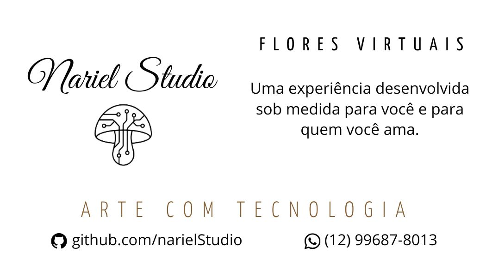

 
 
  <h1 style="color: #333; margin-bottom: 10px;">Nariel Studio — Flores Virtuais 🌸</h1>
  
  

    Uma experiência desenvolvida sob medida para você e para quem você ama.
  

  

    Transformamos sentimentos em código criando sites de presentes exclusivos e totalmente personalizados para aniversários, namoros, casamentos e momentos especiais. Inclua fotos, audios e mensagens marcantes em uma página única que fica no ar por 30 dias com a segurança e velocidade do Cloudflare.
  

  
Um cartão em pdf para a entrega do link. 
 Um site no ar por um mês. 
 Um arquivo pdf com todos os buquês e mensagens. 

  
Tudo preparado com muito carinho depois de uma anamnese

  
  

  <!-- Botão de Demonstração do Site -->
  

    <h2 style="font-size: 1.3em; color: #333; margin-bottom: 12px;">🌐 Acesse a Demonstração Ao Vivo</h2>
    
Clique no botão abaixo para abrir o modelo do site e ver como o presente funciona na prática:

    <a href="https://narielstudio.github.io/ProjetoFlores/index.html" target="_blank" style="display: inline-block; background-color: #D4AF37; color: white; text-decoration: none; padding: 12px 30px; font-weight: bold; border-radius: 8px; box-shadow: 0 2px 5px rgba(0,0,0,0.2);">
      👉 CLIQUE AQUI PARA VER O SITE PRONTO
    </a>
  

  

  

 
  

